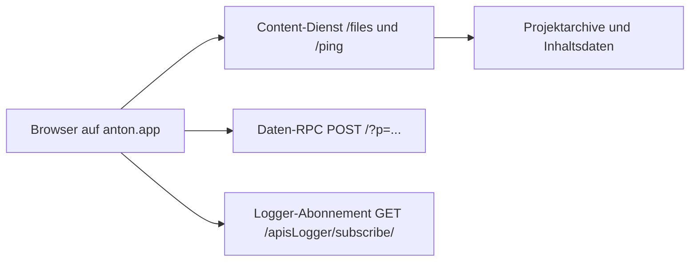

# Client und API-Architektur

Die Startseite wird als HTML von `anton.app` ausgeliefert; der beobachtete Header nennt Express [S1]. Im HTML liegt ein Browserify-Bundle mit einem eingebetteten `package.json`, das LiveScript, Browserify, Express, Lodash und Store2 aufführt [S1]. Daraus ist die verwendete Build- und Clienttechnik belegbar; die genauen aktuellen Serverversionen sind daraus nicht ableitbar.

Der Startcode lädt ein versioniertes Projektarchiv von `content.anton.app` bzw. `content-2.anton.app` [S1, S2, N1]. Im Browser lag `app01` in Version 5002 und `logger01` in Version 138; die öffentlichen Archive sind unter S3/S4 identifiziert. Sie enthalten jeweils viele kleinere, bereits in JavaScript übersetzte `.ls`-Module. Der Client hält Projektmodule und Daten lokal vor; REA sah Speicherschlüsselnamen und Cache-Namen `project` und `store`, aber keine Speicherwerte [REA-Evidence in EVIDENCE.md].

Die Daten-API ist für den beobachteten Login kein REST-Pfadbaum. Die Funktion `pllsCall` sendet JSON per `XMLHttpRequest` an den Root-Pfad eines ausgewählten `*-apis-db.anton.app`-Hosts. Der Query-Wert `p` trägt den logischen Operationsnamen; der JSON-Body trägt `path`, `params` und Kontextfelder [S3: `lib/util/pllsCall/{calcUrl/calc,send/send}.ls`; N4]. Der Host wird aus mehreren Präfixen gewählt. Beobachtet wurde `a-apis-db.anton.app` [N4].

Für Ereignisprotokolle nutzt der Client einen separaten Logger. Ein GET auf `/apisLogger/subscribe/` holt Ereignisse und Synchronisationsmetadaten [S4: `lib/getEvents/getEvents.ls`; N5]. Der Logger-Code enthält außerdem SocketCluster und einen WebSocket-basierten Pfad; dessen konkrete HTTP-/WebSocket-Nachrichten wurden in dieser Untersuchung nicht bestätigt und sind nicht in OpenAPI modelliert [S4: `lib/logServerApi.ls`].

Die Content-Datei `/files/` ist polymorph: Für verschiedene `fileId`-Werte wurden Text, JSON und Bilder beobachtet [N1, N3, N6]. Die API-Spezifikation beschreibt deshalb nur die gemessenen Varianten. Weitere dynamisch zusammengesetzte Pfade und Serververhalten bleiben offen.
