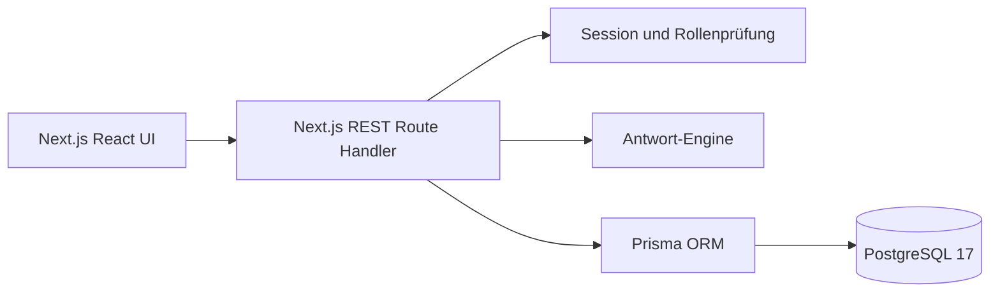

# Lernwerk-Architektur

Next.js 15 liefert Seiten und Node.js-Route-Handler aus einem Prozess. React 19 und Tailwind CSS 3 rendern die responsive Oberfläche. Prisma 6 verwaltet das PostgreSQL-Schema und Migrationen. Die Plattform ruft keine ANTON-Dienste auf; [die Referenzanalyse](REVERSE_ENGINEERING.md) ist eine getrennte Forschungsdokumentation.

## Ablauf einer Übung

1. Der Katalog zeigt nur veröffentlichte Fächer, Themen und Lektionen.
2. `GET /api/lessons/{id}` liefert Fragen mit Typ, Text, Darstellungskonfiguration und Punkten. Die Lösung wird durch eine explizite Prisma-`select`-Liste ausgeschlossen.
3. Der Browser rendert die passende Eingabe in `QuestionPlayer`. Er sendet die Antwort an `POST /api/attempts`.
4. `evaluateAnswer` normalisiert und prüft auf dem Server. Eine Transaktion schreibt den Versuch, vergibt bei der ersten richtigen Antwort Punkte und berechnet Lektionen-Fortschritt neu.
5. Fortschritt und Belohnungen werden aus PostgreSQL geladen und über die eigene API angezeigt.

## Rollen und Sitzungen

`STUDENT` liest veröffentlichte Inhalte, übt und tritt Klassen bei. `TEACHER` verwaltet eigene Klassen und Zuweisungen. `ADMIN` verwaltet alle Inhalte, Nutzer, Rollen und Einstellungen. Passwörter werden mit scrypt und individuellem Salt gehasht. Sitzungen nutzen zufällige, undurchsichtige Tokens; gespeichert wird nur ein HMAC. Die Cookie-Lebensdauer beträgt 30 Tage. Mutationen prüfen den Origin, damit Browser-Sessions gegen Cross-Site-Requests geschützt sind.

## Grenzen

Die Oberfläche und Beispielaufgaben sind bewusst eigenständig. Keine ANTON-Marken, Grafiken oder Aufgaben wurden übernommen. Reale Lehrer- und Administrationsseiten des Testkontos waren nicht zugänglich; die entsprechenden Lernwerk-Funktionen sind eigene Entwürfe. Es gibt keine Echtzeit-Synchronisierung, Zahlungsfunktionen oder Offline-Caches. Für große Datenmengen fehlen Pagination und Hintergrundjobs. Ein Reverse-Proxy muss in öffentlicher Produktion TLS bereitstellen.
